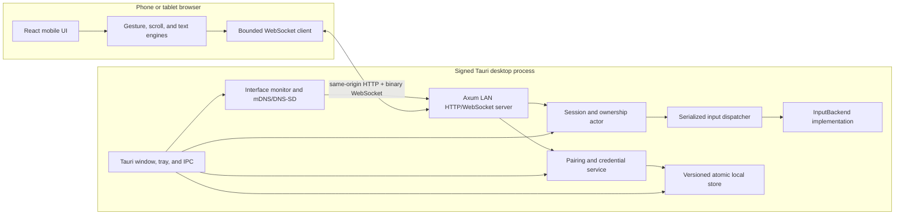

# Tether architecture and feasibility review

**Status:** Review complete; D-01 through D-05 accepted and integrated into
`SPEC.md`. See `architecture-decisions.md` for the binding decision record.  
**Reviewed:** 2026-10-09  
**Authority:** `SPEC.md` is authoritative. This historical review is interpreted
through the accepted record in `architecture-decisions.md`.

## Executive verdict

The specified product is feasible as a production desktop application with a
same-origin LAN web client. The Rust/Tauri/Axum/React/Protocol Buffers split is
sound and should not be replaced.

The highest-risk work is not the basic HTTP/WebSocket path. It is safe input
state under failure, mobile text editing, per-origin browser credentials,
Wayland portal/EI interoperability, X11 text limitations, and release validation
on real operating systems and phones.

Five specification points required owner approval and were accepted on
2026-10-09:

1. how pairing behaves when the browser changes from the stable `.local` host to
   an IP address, or when that IP changes;
2. the supported operating-system policy, especially Windows 10 after its
   general end of support;
3. whether the first launch may expose a listener before the user confirms the
   selected LAN;
4. the honest X11 text-insertion guarantee; and
5. the boundary of the release-all guarantee for uncatchable process or machine
   failure.

The resolution and consequences are recorded in `architecture-decisions.md`.

## Review basis

The review covered all of `SPEC.md`, the current three-file repository, and the
current official documentation linked throughout this document. In particular:

- Chrome's Local Network Access policy now gates relevant address-space
  transitions, but the current rollout does not invalidate a page loaded from a
  LAN origin opening a same-origin LAN WebSocket. The policy is evolving, so it
  belongs in browser compatibility tests. [Chrome Local Network Access](https://developer.chrome.com/blog/local-network-access)
- Plain HTTP is not a secure context, so the specification is correct not to
  require Service Workers, Web Crypto, or the asynchronous Clipboard API.
  [MDN secure-context feature list](https://developer.mozilla.org/en-US/docs/Web/Security/Defenses/Secure_Contexts/features_restricted_to_secure_contexts)
- Browser WebSocket handshakes can carry cookies and an `Origin`; origin checks
  prevent browser cross-site use but do not authenticate non-browser clients.
  [RFC 6455](https://www.rfc-editor.org/info/rfc6455/)
- mDNS names are link-local and conflicts are part of the protocol. Android's
  resolver has supported `.local` resolution since November 2021, but an IP QR
  fallback is still required. [RFC 6762](https://www.rfc-editor.org/info/rfc6762/),
  [Android DNS resolver](https://source.android.com/docs/core/ota/modular-system/dns-resolver)
- The Wayland RemoteDesktop portal explicitly supports relative pointer, both
  scroll axes, keyboard input, persistence tokens, and `ConnectToEIS`, but every
  session remains subject to the portal implementation and user grant.
  [XDG RemoteDesktop portal](https://flatpak.github.io/xdg-desktop-portal/docs/doc-org.freedesktop.portal.RemoteDesktop.html)
- Tauri supports the intended desktop packaging and test surfaces. Linux
  packages still depend on distribution-provided WebKitGTK/GTK libraries; end
  users do not need developer runtimes. [Tauri distribution](https://v2.tauri.app/distribute/),
  [Tauri Debian packaging](https://v2.tauri.app/distribute/debian/),
  [Tauri testing](https://v2.tauri.app/develop/tests/)

## Proposed system architecture

The Tauri process owns the lifecycle, but the shell does not own business logic.
The LAN server, pairing store, session actor, discovery service, and input
dispatcher are reusable Rust components. Administrative mutations are available
only through Tauri IPC. The LAN server exposes static assets, narrow pairing and
status routes, and the authenticated control WebSocket.

## Concrete findings

### Blockers and contradictions

#### AR-001 — A host-only credential cannot follow a hostname or IP change

`HttpOnly; SameSite=Strict` works over HTTP without `Secure`, but a host-only
cookie is returned only to the exact host that set it. A cookie set by
`tether-xxxx.local` is not sent to `192.168.1.20`; a cookie set by that IP is not
sent after DHCP changes it to `192.168.1.37`. Cookies are also shared across
ports on the same host, which means a port change is different from a host
change. [RFC 6265](https://www.rfc-editor.org/info/rfc6265/)

This conflicts with the unqualified statement that a paired phone reconnects
without pairing again. Seamless credential portability would require exposing a
credential to JavaScript or adding a different cryptographic credential design;
both materially change the security architecture.

**Recommended clarification:** pairing is scoped to the browser host. Use the
stable `.local` name as the canonical host. An IP fallback, DHCP-changed IP, or
mDNS conflict rename requires a one-time re-pair for that new host. The UI must
say so. Do not weaken `HttpOnly` to hide this limitation.

#### AR-002 — “Maintained Windows 10” is no longer a general support target

Windows 10 22H2 Home/Pro and ordinary Enterprise/Education support ended on
2025-10-14. LTSC and paid ESU cases have separate lifecycles. The specification
simultaneously requires maintained OS versions and Windows 10, so the release
claim is ambiguous. [Microsoft Windows 10 lifecycle](https://learn.microsoft.com/en-us/lifecycle/announcements/windows-10-end-of-support)

**Recommended clarification:** Windows 11 is Tier 1. Support Windows 10 only on
still-serviced LTSC/IoT/ESU installations; permit best-effort operation on
22H2 without calling that OS configuration supported.

#### AR-003 — “Every” release-all path has a physical limit

The application can and must release input on every event it can observe:
WebSocket close/error, heartbeat expiry, backpressure shutdown, revocation,
ownership transfer, page departure report, network rebinding, sleep/session
transition, graceful quit, panic unwind where possible, and backend failure.

No in-process design can run cleanup after `SIGKILL`, `TerminateProcess`, kernel
panic, power loss, or a backend that can no longer post release events. A second
privileged watchdog would still not solve power loss and would materially expand
the product.

**Recommended clarification:** the absolute requirement applies to every
observable and graceful loss path. Add best-effort RAII/panic cleanup and a
startup neutralization attempt, while documenting uncatchable termination as an
OS limit.

### High-risk platform and product gaps

#### AR-004 — LAN-only needs an application-level admission rule

Binding “selected interfaces” is not by itself a LAN boundary. A selected
interface can have a globally routable IPv6 address, a broad VPN route, or a
public network profile. Cross-platform adapter classification is advisory, as
the specification already notes.

**Proposed design:** listen only on addresses belonging to explicitly enabled
interfaces, and by default accept peers only when their address is on-link under
one of the selected interface prefixes. Exclude loopback, VPN, virtual, bridge,
container, link-local-only, and temporary/tunnel interfaces from defaults where
they can be identified. Advanced routed-LAN exposure, if ever added, must be an
explicit setting with a warning. Firewall rules remain defense in depth.

This rule is especially important for IPv6: do not equate “global IPv6” with
“not local”; use the interface prefix and peer address instead.

#### AR-005 — First-launch exposure and network consent are underspecified

The first-launch sequence starts the server before any explicit network choice,
while settings include “auto-start listening” without a default. The threat
model warns against public networks, and network classification cannot prove a
LAN is trusted.

**Recommended behavior:** initialize the core and inspect interfaces, then ask
the desktop user to confirm the proposed interface(s) and private-LAN warning
before the first non-loopback listener starts. Later launches may auto-listen
only if the user enabled that setting. Pairing still always needs desktop
approval.

#### AR-006 — macOS has two independent permission surfaces

The spec covers Accessibility permission but omits Local Network privacy.
Starting with macOS 15, a normal bundled application may be blocked until the
user grants Local Network access. The bundle needs
`NSLocalNetworkUsageDescription`; Bonjour declarations and signed app identity
also affect reliable behavior. There is no general API that simply returns the
current permission state, so diagnostics must infer denial from failed network
operations and offer retry guidance. [Apple TN3179](https://developer.apple.com/documentation/technotes/tn3179-understanding-local-network-privacy),
[NSLocalNetworkUsageDescription](https://developer.apple.com/documentation/BundleResources/Information-Property-List/NSLocalNetworkUsageDescription)

Accessibility event-posting permission should be checked with the supported
CoreGraphics preflight/request APIs. The UI must distinguish it from Local
Network permission. [CoreGraphics access functions](https://developer.apple.com/documentation/coregraphics/core-graphics-functions)

#### AR-007 — X11 cannot promise arbitrary Unicode through XTEST

XTEST injects keycodes and button/motion events. XKB maps those keycodes to the
current layout; it is not a general UTF-8 text insertion channel. Mutating the
global X keyboard map to manufacture characters is disruptive and not acceptable
for production. [XTEST specification](https://www.x.org/releases/current/doc/xextproto/xtest.pdf),
[XKB specification](https://www.x.org/releases/current/doc/libX11/XKB/xkblib.html)

**Recommended behavior:** physical keys and layout-mappable text are supported.
Arbitrary text is capability-gated and may be unavailable. Compose and Send must
show a precise unsupported-character error instead of reporting success.
Clipboard-paste emulation is not a silent fallback because it mutates sensitive
user state.

`x11rb` supplies the X11 protocol/XTEST layer, but robust current-layout and
state handling will likely also need `libxkbcommon-x11` through maintained Rust
bindings or isolated FFI. Its supported workflow creates a keymap/state from the
active X server and listens for map and state changes. This is a justified native
dependency, subject to the X11 spike and packaging review, rather than a new
architectural layer. [libxkbcommon X11 support](https://xkbcommon.org/doc/current/group__x11.html)

#### AR-008 — Wayland is feasible, but the Rust EI adapter needs a gate

The portal's `ConnectToEIS` architecture is correct. EI provides relative
pointer motion, scroll, buttons, keycodes, and an optional UTF-8 text interface;
UTF-8 messages are limited to 254 characters/255 bytes and must be chunked on
code-point boundaries when the compositor advertises that interface.
[EI protocol](https://libinput.pages.freedesktop.org/libei/),
[EI text interface](https://libinput.pages.freedesktop.org/libei/interfaces/ei_text/)

The current `reis` crate describes itself as incomplete and subject to change.
It is suitable for a time-boxed compatibility spike, not an unconditional
architecture commitment. [reis documentation](https://docs.rs/reis/latest/reis/)

**Proposed gate:** keep EI behind an internal Wayland adapter. Validate `ashpd`
and `reis` against supported GNOME and KDE sessions, including device pause,
resume, keymap, persistence-token rotation, and release ordering. If it fails,
request approval for isolated `libei` C FFI rather than changing the portal
architecture or using privilege escalation.

#### AR-009 — Mobile live text editing is necessarily best effort

`beforeinput` is appropriate but does not fire for every edit and is sometimes
non-cancelable for IME, correction, autofill, and other browser/OS paths.
[MDN `beforeinput`](https://developer.mozilla.org/en-US/docs/Web/API/Element/beforeinput_event)

The live mode must therefore operate on a dedicated local edit buffer, send only
confirmed representable operations, and fall back to Compose and Send when an
edit cannot be mapped. It must never pretend to mirror the focused desktop field.
This agrees with the intent of the specification but needs explicit component
contracts and real-device tests.

#### AR-010 — Current Wi-Fi name is not a reliable required field

SSID access is privacy-gated on recent macOS and may also be gated by location
consent/policy on Windows. Tether should not request location solely to make a
status label prettier. [Apple CoreWLAN guidance](https://developer.apple.com/forums/thread/732431),
[Microsoft Native Wi-Fi API](https://learn.microsoft.com/en-us/windows/win32/api/wlanapi/nf-wlanapi-wlanqueryinterface)

**Proposed interpretation:** “Current network” means interface type/name and
address by default. Show SSID only when already available without adding a new
permission; otherwise show “Wi-Fi network name unavailable.”

### Security and reliability requirements missing from the spec

These are refinements inside the required architecture, not framework changes:

- Put the QR pairing token in the URL fragment, not the query string. Fragments
  are not sent in the initial HTTP request. The page submits it in a bounded POST
  body and immediately calls `history.replaceState`. Access logs must exclude
  request bodies, query strings, `Cookie`, and `Set-Cookie`.
- Use a 256-bit random pairing token and credential, constant-time hash
  comparison, single-use/expiry state, bounded pending approvals, and immediate
  revocation. A random 256-bit credential can be stored as a SHA-256 digest; a
  password-hardening KDF adds cost without meaningful protection against brute
  forcing that entropy.
- Scope the credential cookie to the control WebSocket path, omit `Domain`, set
  `HttpOnly; SameSite=Strict; Path=/control`, and set an explicit persistent
  lifetime. It cannot use `Secure` on baseline HTTP, nor a
  `__Host-` prefix, which requires `Secure`.
- Treat browser cookie retention as best effort. Browsers and users may purge it;
  re-pairing is the recovery path.
- Canonicalize and allowlist `Host` and `Origin` authorities, including port,
  bracketed IPv6, case, and optional trailing-dot hostname form. Reject absent
  browser origins. Origin is defense against browser cross-site access, not
  authentication; non-browser clients can forge it.
- Do not enable permissive CORS. Do not expose paired-device administration,
  settings mutation, logs, or stop/revoke operations over LAN HTTP.
- Use restrictive CSP, `frame-ancestors 'none'`, `Referrer-Policy: no-referrer`,
  `X-Content-Type-Options: nosniff`, no inline script, and no third-party assets.
- Bound HTTP bodies and deadlines before deserialization. Mark cookie headers
  sensitive before HTTP tracing. `tower-http` has explicit body-limit, timeout,
  and sensitive-header support. [tower-http body limits](https://docs.rs/tower-http/latest/tower_http/limit/),
  [sensitive headers](https://docs.rs/tower-http/latest/tower_http/sensitive_headers/)
- Configure WebSocket frame/message/write limits explicitly; library defaults
  are far too large for control traffic. [tungstenite limits](https://docs.rs/tungstenite/latest/tungstenite/protocol/struct.WebSocketConfig.html)
- Disable WebSocket compression unless a measured need appears. Tiny input
  messages do not justify compression state, latency, or decompression risk.
- Add global and per-peer limits for unauthenticated HTTP, pending pairings,
  WebSockets, authentication attempts, and control messages. Rate limiting must
  not delay the local emergency stop or release-all path.
- Use a single-instance desktop application. Multiple processes would compete
  for the port, mDNS identity, settings store, tray state, and input ownership.
- Store settings and paired-device hashes in versioned, atomic files in the OS
  application-data directory, with owner-only permissions where supported.
  Corrupt state must be quarantined and fail closed for credentials.
- Observe suspend/resume, session lock/logout, network-address changes, and
  graceful process signals. Suspend/session loss must stop admission and release
  input before the platform sleeps where notification timing permits.
- Never derive logs with `Debug` from protocol objects containing text or keys.
  Sensitive payload types need redacted `Debug` implementations, and raw frames
  must never enter traces even at trace level.

### Protocol and queue clarifications

The authoritative schema should define one envelope per binary WebSocket
message. The opening handshake negotiates a WebSocket subprotocol such as
`tether.control.v1`; protobuf hello messages then negotiate the compatible
application protocol and capabilities. Incompatible major versions close with a
specific user-visible reason.

Sequence numbers are monotonic within a connection/session epoch. They detect
client bugs and stale work; they are not transport acknowledgements. Client
timestamps are monotonic durations meaningful only on that client and must not
be compared directly with the desktop clock.

The input path has two levels:

1. the browser coalesces motion/scroll at animation-frame cadence without
   coalescing across state-changing down/up boundaries; and
2. the server session actor feeds a bounded serialized dispatcher.

Release and ownership-loss commands are control-plane operations. If the normal
action queue fills, the actor clears pending motion, suspends that session,
invokes release-all directly in actor order, and closes the connection. It does
not enqueue a release behind an already unsafe backlog. Browser
`WebSocket.bufferedAmount` is useful for detecting the client-side queue but is
not a complete backpressure API. [MDN `bufferedAmount`](https://developer.mozilla.org/en-US/docs/Web/API/WebSocket/bufferedAmount)

Initial limits should be deliberately small and then tuned by contract tests and
hardware measurements. The design review recommends a 64 KiB WebSocket message
ceiling, 4 KiB pairing/request bodies, bounded text chunks, and low double-digit
connection limits; exact constants belong in the network and protocol component
documents before those tasks begin.

## Native backend feasibility

### Windows

`SendInput` supports the required pointer, buttons, vertical/horizontal wheel,
scan-code keys, Unicode packets, and media keys. UIPI permits injection only into
equal- or lower-integrity applications, and Windows does not reliably report
that UIPI caused a zero-result failure. Relative motion is additionally affected
by the user's Windows pointer speed/thresholds, so Tether acceleration is an
extra layer rather than a replacement for OS settings. [Microsoft `SendInput`](https://learn.microsoft.com/en-us/windows/win32/api/winuser/nf-winuser-sendinput),
[Microsoft `MOUSEINPUT`](https://learn.microsoft.com/en-us/windows/win32/api/winuser/ns-winuser-mouseinput),
[Microsoft `KEYBDINPUT`](https://learn.microsoft.com/en-us/windows/win32/api/winuser/ns-winuser-keybdinput)

The backend is feasible with honest limitations for elevated windows, secure
desktop, physical-key interference, and application-specific Unicode handling.
Do not elevate the whole application.

### macOS

CoreGraphics supplies mouse, keyboard, multi-axis scrolling, and Unicode event
payload APIs. Apple explicitly warns that application frameworks may ignore a
Unicode string and translate the virtual key/event state themselves, matching
the spec's need for application testing. [Apple `CGEvent`](https://developer.apple.com/documentation/coregraphics/cgevent),
[Unicode event behavior](https://developer.apple.com/documentation/coregraphics/cgevent/keyboardsetunicodestring%28stringlength%3Aunicodestring%3A%29)

The backend is feasible with Accessibility onboarding, Local Network onboarding,
signed/notarized identity, and real application tests.

### Linux X11

Relative pointer, buttons, keycodes, and wheel-button conventions are feasible
with XTEST/XKB. Arbitrary Unicode is conditional as described in AR-007. XTEST
availability must be queried at runtime and reported as a capability.

### Linux Wayland

The portal/EI path is feasible where the compositor implements it. Restore
tokens are single-use and replaced after successful restoration; permission can
still be withdrawn or restoration refused. Startup must tolerate a new user
prompt or unavailable input. No X11 fallback may be used while running a Wayland
session merely because XWayland is present.

## Packaging and validation feasibility

- Windows: Tauri produces NSIS/MSI installers. Firewall rules should be created
  by the installer only when narrowly scoped and approved; the normal agent stays
  unelevated.
- macOS: build a universal application/DMG if the chosen release toolchain still
  supports both architectures; sign and notarize public artifacts. Local Network
  privacy tracks signed identity, so unsigned/ad-hoc builds are insufficient for
  final permission validation.
- Linux: build `.deb` on the oldest supported WebKitGTK 4.1/glibc baseline,
  produce `.rpm` natively, and treat AppImage as a convenience artifact rather
  than the only supported package. Native packages may declare OS libraries;
  they must not require Node, Python, Rust, `xdotool`, or a separate server.
- Browser automation can cover Chromium and Playwright WebKit layouts and
  state machines. It cannot validate iOS software keyboards, actual Safari
  process suspension, OS LAN permissions, or real `.local` resolution. Those
  remain signed manual test records on physical devices.
- Native injection tests stay opt-in. Mock-backend contract and failure tests run
  in normal CI; platform labs run destructive input tests in isolated sessions.

## Accepted approval decisions

The project owner approved these decisions as a set on 2026-10-09:

| ID | Recommended decision | Consequence |
|---|---|---|
| D-01 | Keep the `HttpOnly` host-only cookie. Treat each hostname/IP as a separate pairing scope; IP or mDNS-name changes can require re-pairing. | Preserves the specified browser security boundary and makes fallback limitations honest. |
| D-02 | Tier 1 is Windows 11 x86-64, vendor-maintained macOS on arm64, and named Linux x86-64 distro/compositor releases. Windows 10 is supported only on vendor-serviced LTSC/IoT/ESU configurations; unserviced 22H2 is best effort. macOS x86-64 remains supported only while the selected OS/toolchain and real Intel hardware can validate it. Linux arm64 becomes a release target only after native hardware/package validation. Mobile claims name current tested Safari/iOS/iPadOS and Chrome/Android versions. | Replaces ambiguous “maintained versions” and “where practical” language with testable release claims. |
| D-03 | On first launch, require desktop confirmation of proposed LAN interfaces before opening a non-loopback listener. Default admission is selected-interface plus on-link peer prefix. Auto-listen is later opt-in. | Reduces accidental exposure on public Wi-Fi and makes LAN-only enforceable, at the cost of one onboarding step. |
| D-04 | On X11, promise physical keys and layout-mappable text only. Arbitrary Unicode/emoji is capability-gated and may be unavailable; Compose and Send reports unsupported characters. | Avoids unsafe global keymap mutation and false success. |
| D-05 | “Every connection-loss path releases input” means every observable/graceful path. Add best-effort panic/drop/startup neutralization, but document that kill -9, forced process termination, kernel failure, and power loss cannot execute cleanup. | Makes the safety requirement technically realizable without adding a privileged watchdog architecture. |

## Decisions that do not require an architectural deviation

- Keep plain HTTP/`ws://` as specified and retain the explicit trusted-LAN
  warning. This leaves passive/active LAN interception and replay of a stolen
  cookie as a known residual risk. Optional application-layer encryption may be
  researched later but is not part of the baseline.
- Keep Axum/Tokio, Tauri 2, React/TypeScript/Vite, Protocol Buffers, mDNS/DNS-SD,
  and the platform-native input APIs.
- Use the current `mdns-sd` implementation only after tests for selected
  interfaces, address changes, probing/conflict rename, goodbyes, and macOS
  permission denial. Its current API supports automatic address updates,
  interface filters, and name probing. [mdns-sd `ServiceInfo`](https://docs.rs/mdns-sd/latest/mdns_sd/struct.ServiceInfo.html)
- Use proto3 for the first schema. Reserve removed fields/numbers, validate open
  enum values explicitly, and run Buf lint/breaking/generated-diff checks.
  `prost` preserves unknown enum numeric values but code must still reject
  unsupported commands. [prost](https://github.com/tokio-rs/prost),
  [Buf generation](https://buf.build/docs/generate/)

## Next step

The decisions have been integrated into `SPEC.md`; the accepted/corrected and
rejected proposals are recorded in `architecture-decisions.md`, and residual
platform uncertainty is tracked in `open-risks.md`. Implementation may begin at
F-001 in `implementation-plan.md` after this documentation revision is handed
off. This review remains historical evidence rather than a second specification.
