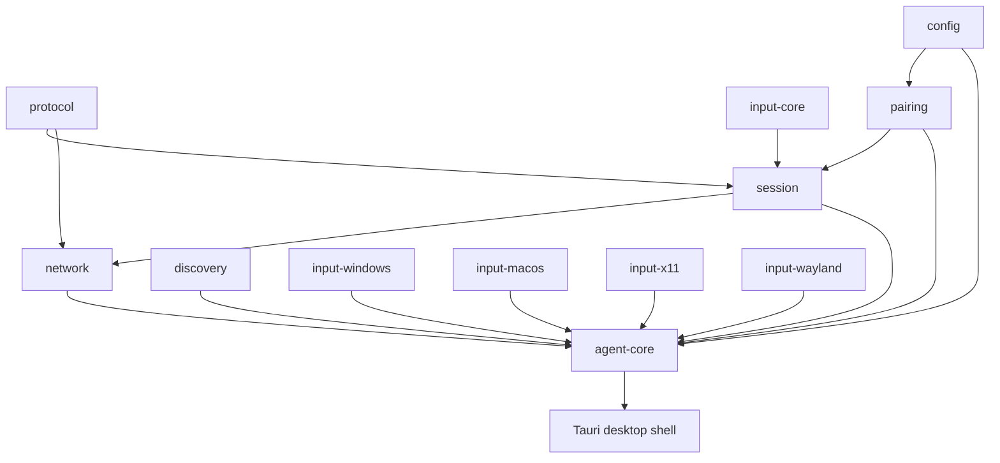

# Repository structure

**Status:** Accepted for implementation. D-01 through D-05 are recorded in
`architecture-decisions.md`; create implementation directories only through the
dependency gates in `implementation-plan.md`.

```text
tether/
├── .cargo/
│   └── config.toml                 # Target/linker policy only when required
├── .github/
│   ├── ISSUE_TEMPLATE/
│   └── workflows/
│       ├── ci.yml                  # Fast cross-platform checks
│       ├── browser.yml             # Chromium/WebKit browser suites
│       ├── native-smoke.yml        # Opt-in/isolated native tests
│       └── release.yml             # Signed packaging gates
├── apps/
│   ├── desktop/
│   │   ├── package.json            # Desktop settings UI package
│   │   ├── src/                    # React desktop UI; IPC client only
│   │   ├── tests/                  # Desktop UI and IPC contract tests
│   │   └── src-tauri/
│   │       ├── Cargo.toml
│   │       ├── capabilities/       # Least-privilege Tauri capabilities
│   │       ├── icons/
│   │       ├── src/
│   │       │   ├── main.rs         # Process entry point
│   │       │   ├── commands.rs     # Narrow Tauri IPC adapters
│   │       │   ├── lifecycle.rs    # Tray/window/quit/suspend integration
│   │       │   └── platform/       # Non-input shell OS hooks
│   │       ├── tauri.conf.json
│   │       └── tauri.*.conf.json   # Per-platform bundle/privacy metadata
│   └── mobile-web/
│       ├── package.json
│       ├── index.html
│       ├── src/
│       │   ├── app/                # Routing and low-frequency UI state
│       │   ├── components/         # Touch-first visual controls
│       │   ├── gesture/            # React-independent state machine
│       │   ├── scroll/             # Axis-specific physics/momentum
│       │   ├── keyboard/           # Live/compose text engine
│       │   ├── network/            # Auth, reconnect, bounded WebSocket
│       │   ├── protocol/generated/ # Reproducible protobuf output
│       │   ├── settings/           # Browser-local preferences/migrations
│       │   └── styles/
│       ├── tests/
│       └── vite.config.ts
├── crates/
│   ├── agent-core/                 # Lifecycle orchestration; no Tauri types
│   ├── config/                     # Versioned settings/storage/migrations
│   ├── discovery/                  # Interfaces, address changes, mDNS/DNS-SD
│   ├── input-core/                 # InputBackend, actions, dispatcher, mock
│   ├── input-macos/                # CoreGraphics implementation
│   ├── input-wayland/              # Portal + isolated EI adapter
│   ├── input-windows/              # Win32 SendInput implementation
│   ├── input-x11/                  # XTEST/XKB implementation
│   ├── network/                    # Static HTTP, pairing routes, WebSocket
│   ├── pairing/                    # Tokens, credential hashes, devices
│   ├── protocol/                   # Generated Rust protobuf + validation
│   ├── session/                    # Ownership, heartbeat, held-state safety
│   └── test-support/               # Deterministic, non-production Rust test utilities
├── docs/
│   ├── adr/                        # Accepted architecture decision records
│   ├── components/                 # One living contract per component
│   ├── manual-tests/               # Versioned hardware/platform evidence
│   ├── operations/                 # Packaging, release, support, diagnostics
│   ├── architecture-review.md
│   ├── architecture-decisions.md
│   ├── documentation-plan.md
│   ├── implementation-plan.md
│   ├── open-risks.md
│   └── repository-structure.md
├── proto/
│   ├── buf.yaml
│   ├── buf.gen.yaml
│   ├── buf.lock                    # If external schemas are ever imported
│   └── tether/control/v1/
│       └── control.proto           # Sole wire-schema authority
├── tests/
│   ├── contract/                   # Rust/TypeScript golden wire fixtures
│   ├── integration/                # Core + network + MockInputBackend
│   ├── e2e/                        # Browser against packaged static server
│   ├── native/                     # Opt-in destructive platform tests
│   └── fixtures/                   # Non-sensitive deterministic test data
├── xtask/                          # Reproducible generation/check/release glue
├── .editorconfig
├── .gitignore
├── AGENTS.md
├── Cargo.lock
├── Cargo.toml
├── README.md
├── SPEC.md
├── deny.toml                       # License/advisory/source policy
├── package.json
├── pnpm-lock.yaml
├── pnpm-workspace.yaml
├── rust-toolchain.toml
└── tsconfig.base.json
```

## Boundary rationale

### `apps/desktop`

This is the only Tauri-dependent package. It renders settings/status, owns tray
and window behavior, converts OS/process lifecycle notifications into core
events, and exposes narrow IPC commands. It does not implement pairing,
networking, session ownership, or input semantics.

The desktop frontend lives beside `src-tauri` because they form one packaged
application. A separate desktop-UI workspace would add indirection without a
consumer outside this shell.

### `apps/mobile-web`

This is a static production bundle served by the Rust network crate. High-rate
input lives in framework-independent engines and mutable refs; React renders
low-rate status and configuration. The generated protobuf client stays inside
this package because it has no second TypeScript consumer.

### Core Rust crates

- `agent-core` composes services and owns ordered startup/shutdown. It depends on
  traits and service handles, not Tauri.
- `config` is a real boundary because atomic persistence, permission hardening,
  schema migrations, and corruption recovery are shared by application settings
  and paired-device state.
- `protocol` turns generated wire values into validated domain actions. Native
  backends never receive raw protobuf messages.
- `input-core` owns platform-neutral action types, capability/status models, the
  serialized dispatcher contract, fractional accumulators, and
  `MockInputBackend`.
- `session` is separate from transport. It owns authentication state,
  controller/standby transitions, heartbeats, sequence/session epochs, pressed
  keys/buttons, and idempotent release-all.
- `pairing` owns temporary token and long-lived device credential lifecycles. It
  uses `config` persistence without knowing HTTP cookies.
- `network` owns local listeners, peer/interface admission, static assets, HTTP
  middleware, cookie translation, WebSocket framing, quotas, and backpressure.
  It delegates identity and control decisions.
- `discovery` owns interface inventory and mDNS/DNS-SD. It emits address-change
  events; it does not restart the server itself.
- `test-support` is a development-only crate for deterministic clocks/random
  streams, private temporary directories, typed sanitized trace capture, and
  no-op OS handles. Release crates may use it only as a dev-dependency.

### Platform crates

Each `input-*` crate implements `InputBackend` and is selected with target
configuration in the desktop composition root. Linux selects X11 or Wayland at
runtime based on the actual session, never by silently injecting through XWayland
from a Wayland session.

Platform crates may expose test-only adapters around native calls, but native
types do not leak into `input-core`, `session`, `network`, or the protocol.

### Tests

- Unit tests remain beside source.
- `tests/contract` owns cross-language protobuf fixtures and generated-code
  consistency.
- `tests/integration` runs real HTTP/WebSocket/session flows with the mock
  backend and temporary storage.
- `tests/e2e` drives browser engines against the same embedded asset handler used
  in production.
- `tests/native` is opt-in, platform-labelled, and refuses to run without an
  explicit environment guard.
- `docs/manual-tests` contains human-signed test records for phone/browser,
  permissions, compositor, installer, and real input behavior.

## Dependency direction



Arrows mean “is consumed by,” not Cargo dependency syntax. The composition root
injects the selected backend into `agent-core`; platform crates do not depend on
`agent-core`.

The network crate may call session and pairing service interfaces but must not
own their state. Discovery reports desired listener addresses to `agent-core`,
which coordinates a safe release, listener transition, and re-advertisement.

## Proposed toolchain policy

- Pin a stable Rust toolchain in `rust-toolchain.toml`; raise it deliberately
  when Tauri or a platform dependency requires a newer MSRV.
- Pin Node and pnpm in the root `package.json`/CI and commit both lockfiles.
- Pin Buf and generation plugins through the repository task runner. Normal
  `cargo build` and `pnpm build` should consume checked-in generated sources and
  must not need network access.
- Make `xtask check-generated` regenerate into a temporary tree and diff, so CI
  detects stale generated code without rewriting the worktree.
- Use target-specific Cargo dependencies and native CI. A successful Linux
  workspace build is not evidence that Windows or macOS platform crates compile.

## Directories intentionally not proposed

- No generic `utils`, `common`, or `services` crate. Shared code should remain
  with the component that owns its invariant until a second real owner exists.
- No database crate. The data volume needs a versioned atomic local store, not a
  server database.
- No telemetry or analytics package.
- No sidecar web server or input automation binary.
- No shared frontend design-system package until both UIs actually need a stable
  shared component contract.
